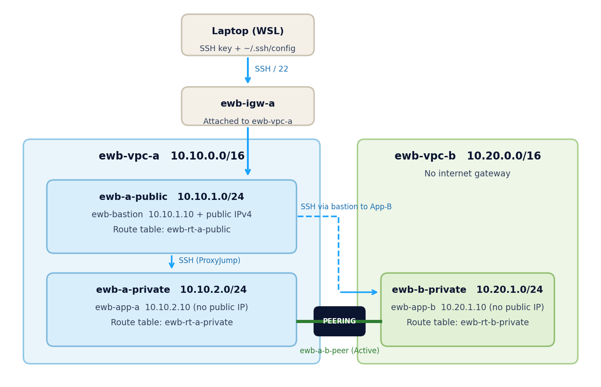

# AWS VPC Peering Project

**Connect two VPCs. Prove private connectivity.**

Hands-on AWS networking project (EWB Cloud Labs, Project 01) built during the **AWS Internship, Batch 1**.
Two private VPCs are connected with VPC peering, and one public bastion host is used to administer both private servers over SSH ProxyJump, with no keys copied onto any server.

| | |
|---|---|
| **Student** | Naman Rathore |
| **Region** | Mumbai (`ap-south-1`) |
| **Completed** | 24 October 2026 |
| **Full report** | [`Naman_Rathore_EWB_VPC_Peering.pdf`](Naman_Rathore_EWB_VPC_Peering.pdf) |

---

## Architecture



- **Administration:** laptop → bastion → App-A or App-B (SSH ProxyJump)
- **Project traffic:** App-A ↔ App-B over private IPs through the peering connection
- VPC B has **no internet gateway** and neither app server has a public IP

### Address plan

| Resource | Name tag | CIDR / IP |
|---|---|---|
| VPC A | `ewb-vpc-a` | `10.10.0.0/16` |
| Public subnet | `ewb-a-public` | `10.10.1.0/24` |
| Private subnet | `ewb-a-private` | `10.10.2.0/24` |
| VPC B | `ewb-vpc-b` | `10.20.0.0/16` |
| Private subnet | `ewb-b-private` | `10.20.1.0/24` |
| Bastion | `ewb-bastion` | `10.10.1.10` + public IPv4 |
| App-A | `ewb-app-a` | `10.10.2.10` (no public IP) |
| App-B | `ewb-app-b` | `10.20.1.10` (no public IP) |

Other resources: internet gateway `ewb-igw-a`, route tables `ewb-rt-a-public`, `ewb-rt-a-private`, `ewb-rt-b-private`, security groups `ewb-sg-bastion`, `ewb-sg-app-a`, `ewb-sg-app-b`, peering connection `ewb-a-b-peer`, key pair `ewb-lab`.
Instances: Amazon Linux 2023, `t3.micro`.

---

## What this project demonstrates

- Planning **non-overlapping** VPC and subnet CIDRs
- Public and private subnets with **explicit route table associations**
- Activating peering and configuring **forward and return routes**
- **Least-privilege** security groups (single `/32` sources, nothing open to `0.0.0.0/0`)
- Private administration with a **bastion + SSH ProxyJump**
- Proving the design with a **failed baseline test, successful tests, and a controlled failure**
- Full **cleanup** of every lab resource

---

## Routing

| Route table | Destination | Target | Purpose |
|---|---|---|---|
| `ewb-rt-a-public` | `10.10.0.0/16` | local | Bastion to App-A |
| `ewb-rt-a-public` | `0.0.0.0/0` | internet gateway | Bastion internet access |
| `ewb-rt-a-public` | `10.20.0.0/16` | peering | Bastion SSH to App-B |
| `ewb-rt-a-private` | `10.10.0.0/16` | local | VPC A traffic |
| `ewb-rt-a-private` | `10.20.0.0/16` | peering | App-A to VPC B |
| `ewb-rt-b-private` | `10.20.0.0/16` | local | VPC B traffic |
| `ewb-rt-b-private` | `10.10.0.0/16` | peering | Return path to VPC A |

Screenshots: [VPC A map](screenshots/01_vpc-a_resource_map.png), [VPC B map](screenshots/02_vpc-b_resource_map.png), [public RT](screenshots/03_rt-a-public_routes_associations.png), [private RT A](screenshots/04_rt-a-private_routes_associations.png), [private RT B](screenshots/05_rt-b-private_routes_associations.png), [peering Active](screenshots/06_peering_active.png)

## Security group inbound rules

| Security group | Type | Source |
|---|---|---|
| `ewb-sg-bastion` | SSH / TCP 22 | My public IPv4 `/32` |
| `ewb-sg-app-a` | SSH / TCP 22 | `10.10.1.10/32` (bastion) |
| `ewb-sg-app-a` | ICMP IPv4 | `10.20.1.10/32` (App-B) |
| `ewb-sg-app-b` | SSH / TCP 22 | `10.10.1.10/32` (bastion) |
| `ewb-sg-app-b` | ICMP IPv4 | `10.10.2.10/32` (App-A) |

Outbound rules were left at the default allow-all. Network ACLs are the default allow-all.
Screenshots: [bastion SG](screenshots/07_sg_bastion_rules.png), [App-A SG](screenshots/08_sg_app-a_rules.png), [App-B SG](screenshots/09_sg_app-b_rules.png)

---

## SSH configuration (ProxyJump)

All SSH commands run on my laptop. The private key never leaves it.

```
Host ewb-bastion
    HostName <BASTION_PUBLIC_IP>
    User ec2-user
    IdentityFile ~/.ssh/ewb-lab.pem
    IdentitiesOnly yes

Host ewb-app-a
    HostName 10.10.2.10
    User ec2-user
    IdentityFile ~/.ssh/ewb-lab.pem
    IdentitiesOnly yes
    ProxyJump ewb-bastion

Host ewb-app-b
    HostName 10.20.1.10
    User ec2-user
    IdentityFile ~/.ssh/ewb-lab.pem
    IdentitiesOnly yes
    ProxyJump ewb-bastion
```

---

## Test results

| # | Test | Where / command | Expected | Result | Evidence |
|---|---|---|---|---|---|
| 01 | Baseline | App-A: `ping -c 4 10.20.1.10` (no path to VPC B) | No replies | 0 received, 100% loss | [screenshot](screenshots/13_test01_baseline_app-a_ping_fail.png) |
| 02 | Forward path | App-A: `ping -c 4 10.20.1.10` | 4 replies, 0% loss | 4 received, 0% loss | [screenshot](screenshots/14_test02_forward_ping_app-a_to_app-b.png) |
| 03 | Reverse path | App-B: `ping -c 4 10.10.2.10` | 4 replies, 0% loss | 4 received, 0% loss | [screenshot](screenshots/15_test03_reverse_ping_app-b_to_app-a.png) |
| 04 | Private SSH | Laptop: `ssh ewb-app-b` | Shell on App-B via bastion | Shell opened, login from `10.10.1.10` | [screenshot](screenshots/16_test04_ssh_app-b_via_bastion.png) |
| 05 | Isolation | EC2 details of App-A and App-B | No public IPv4 | Public IPv4 empty on both | [App-A](screenshots/11_test05_isolation_app-a_no_public_ip.png), [App-B](screenshots/12_test05_isolation_app-b_no_public_ip.png) |

Bastion instance details: [screenshot](screenshots/10_instance_bastion_details.png)

### Controlled failure and recovery

To prove that the security group (not only the route) controls the traffic, I removed only the ICMP rule on `ewb-sg-app-b`, kept the SSH rule, and re-tested:

1. [ICMP rule removed](screenshots/17_failure_sg_app-b_icmp_rule_removed.png) from `ewb-sg-app-b`
2. [Ping from App-A fails](screenshots/18_failure_ping_fails_app-a.png) (100% packet loss)
3. [Same rule restored](screenshots/19_recovery_sg_app-b_icmp_rule_restored.png)
4. [Ping works again](screenshots/20_recovery_ping_ok_app-a.png) (4 replies, 0% loss)

---

## Forward path and return path

- **Forward (App-A → App-B):** `ewb-rt-a-private` matches `10.20.0.0/16` and sends the packet through the peering connection. `ewb-sg-app-b` allows ICMP from `10.10.2.10/32`.
- **Return (App-B → App-A):** `ewb-rt-b-private` matches `10.10.0.0/16` and sends the reply back through the same peering connection. Security groups are stateful, so the reply is allowed automatically.
- **Administration:** with ProxyJump the bastion opens a separate SSH connection to App-B, so App-B sees the **bastion's private IP** as the source. That is why `ewb-sg-app-b` allows SSH only from `10.10.1.10/32`, and why `ewb-rt-a-public` needs a route to `10.20.0.0/16`.

## Key concepts

- Peering is only a **link**. Routes on both sides and security group rules decide whether traffic can use it.
- Peering is one-to-one and **non-transitive**, and it does not give VPC B internet access through VPC A's internet gateway.
- The two VPC CIDRs must not overlap.

---

## Cleanup

After saving all evidence I deleted every resource created for this project (instances and volumes, peering routes and connection, security groups, subnets, custom route tables, internet gateway, both VPCs).

- [EC2 instances terminated](screenshots/21_cleanup_instances_terminated.png)
- [No leftover volumes](screenshots/22_cleanup_no_volumes.png)
- [Only the default VPC remains](screenshots/23_cleanup_vpc_list_default_only.png)

---

## Repository structure

```
.
├── README.md
├── Naman_Rathore_EWB_VPC_Peering.pdf   # full project report
├── architecture.png
├── .gitignore                          # keeps *.pem out of the repo
└── screenshots/                        # numbered evidence, in report order
```

## Security notes

- No private keys, passwords or access tokens are stored in this repository (`*.pem` is git-ignored).
- SSH to the bastion was allowed only from my own public IP `/32`; no rule exposes SSH or ICMP to `0.0.0.0/0`.
- Both application servers stayed private (no public IPs).

## Author

**Naman Rathore**: [GitHub](https://github.com/Naman-Rathore23)
